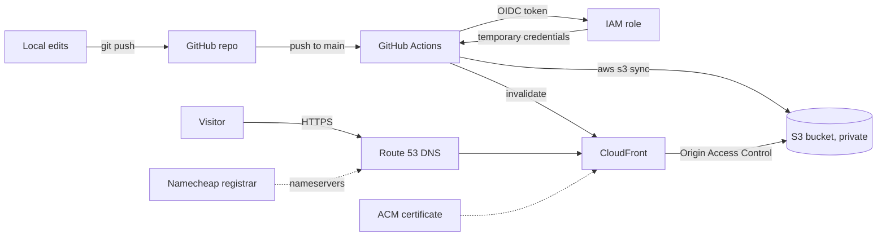

# Architecture

## Design choices

- **Private bucket + OAC.** The bucket is never public. Only CloudFront can read it.
- **OIDC, not access keys.** GitHub Actions gets short-lived credentials per run. Nothing long-lived is stored in GitHub.
- **Least-privilege role.** The deploy role can write to one bucket and invalidate one distribution. Nothing else.
- **Cache split.** HTML caches for 5 minutes so updates show fast. CSS and images cache for a day.
- **Git is the source of truth.** Files in S3 are never edited by hand. Every change goes through a commit.
